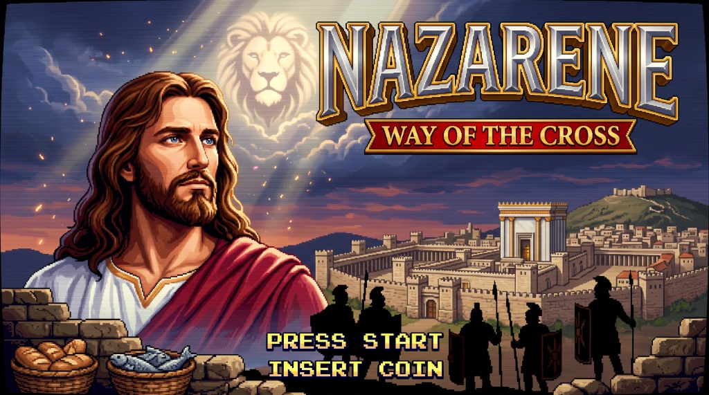

  

# The Nazarene: Way of the Cross

> A 16-bit 2D arcade action platformer heavily inspired by the original 1987 Sega arcade classic *Shinobi*, set in 1st-century Roman-occupied Judea.

---

### 🌟 Game Highlights

- **Jerusalem Campaign Map:** Authentic arcade parchment map tracking 3 distinct mission areas with active pulsing target reticles and crimson Roman `[DEFEATED]` stamps.
- **Three Unique Stages & Bosses:**
  - **Stage 1 (Via Dolorosa):** Roman streets and aqueducts &bull; Boss: **Centurion Brutus** with barbed combat whip.
  - **Stage 2 (The Inner Temple):** Vaulted sanctuary and multi-tier mezzanines &bull; Wall-crawling **Sicarii Shadow Assassins** &bull; Boss: **Temple Commander Malchus**.
  - **Stage 3 (Golgotha Citadel):** Mountain crags and fortress battlements &bull; Dynamic storm clouds &bull; Boss: **Tribunal Praetor Longinus**.
- **Arcade Combat & Dual-Plane Traversal:**
  - High-velocity iron spike throws, automatic close-range palm/staff strikes (< 24px), low crouch attacks, and somersault super-leaps (`Up + Jump`) between upper and lower tiers.
  - Tactical boss armor deflections requiring jump headshots, rear attacks, or Divine Wrath.
  - Dramatic **"FINISH HIM!"** lightning showdown when bosses reach 1 HP.
- **Divine Wrath & Ascension Finale:** Screen-clearing Lion of Judah ninjutsu; upon final victory, the storm clouds part, a vibrant 7-band rainbow appears, angelic choirs sing, and Jesus ascends diagonally into heaven.

---

### 💻 System Compatibility & Requirements

| Platform / Target | Compatibility & Details |
| :--- | :--- |
| **Windows Desktop** | **Windows 10 & 11 (64-bit)** &bull; Standalone portable executable (`Nazarene.exe`) with **zero runtime dependencies** or external DLLs. &bull; Locked 60 FPS internal 320x224 rendering with clean integer scaling up to 1280x896 or borderless fullscreen (`F11` / `Alt+Enter`). |
| **Controllers & Gamepads** | **Plug & Play Support**: &bull; **XInput / DirectInput**: Xbox Wireless, DualShock 4, DualSense, 8BitDo, Switch Pro, @Play arcade sticks, and generic USB gamepads. &bull; Full keyboard support (Arrows / `WASD` + `Space` / `J` / `K`). |
| **Game Boy Advance** | **Real Hardware & Emulators**: &bull; Native 60 FPS Mode 4 GBA binary (`Nazarene.gba`). &bull; Includes 4MB `0xFF`-padded and header-signed ROM (`Nazarene-padded.gba`) compatible with **SuperCard (SD/CF/MiniSD/Lite)**, EZ-Flash, EverDrive, and emulators (mGBA, RetroArch, VBA). |

---

### 📥 Downloads

- 🎮 **Windows (Latest v2.0):** [Download `Nazarene-v2.0-windows-x64.zip`](https://github.com/andarazoroflove/Nazarene/releases/download/2.0/Nazarene-v2.0-windows-x64.zip) or [Direct `Nazarene.exe`](https://github.com/andarazoroflove/Nazarene/releases/download/2.0/Nazarene.exe)
- 🕹️ **Game Boy Advance:** [Download `Nazarene-padded.zip` (SuperCard)](https://github.com/andarazoroflove/Nazarene/releases/download/1.0gba/Nazarene-padded.zip) or [Direct `Nazarene.gba`](https://github.com/andarazoroflove/Nazarene/releases/download/1.0gba/Nazarene.gba)

---

### 🕹️ Controls Quick Reference

| Action | Keyboard | Gamepad |
| :--- | :--- | :--- |
| **Move / Crouch** | Arrow Keys / `WASD` | D-Pad / Left Stick |
| **Jump / Super-Leap** | `Space` / `Up + Space` | Button `A` or `B` / `Up + A` |
| **Drop Through Ledge** | `Down + Space` | `Down + Button A` |
| **Attack (Melee / Spike)** | `J` or `Z` | Button `X` / `RB` / `RT` |
| **Divine Wrath (Ninjutsu)**| `K` or `X` | Button `Y` / `LB` / `LT` |
| **Insert Coin / Start** | `C` / `Enter` | `Select` / `Start` |
